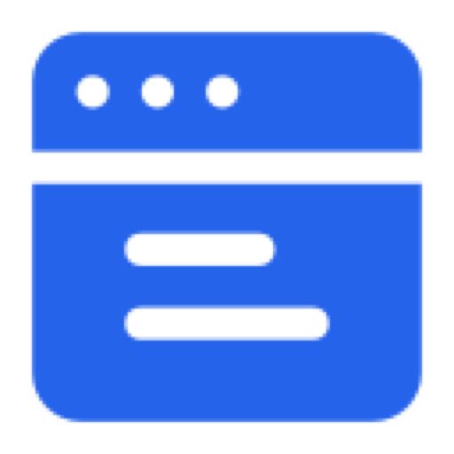

<p align="center">
  <a href="https://github.com/ashu-tosh-kumar/dtoc" target="_blank" rel="noreferrer noopener">
    
  </a>
</p>
<p align="center"><strong>Never get lost in a long web page again.</strong> dtoc adds a clean, clickable <strong>table of contents</strong> to Confluence, Wikipedia, Medium, DEV and any long page. Free, open source, and nothing leaves your browser.</p>
<p align="center">Interactive showcase &amp; guides: <a href="https://uncommonlydone.com/tools/dtoc"><strong>uncommonlydone.com/tools/dtoc</strong></a></p>
<br/>
<p align="center">
  <a rel="noreferrer noopener" href="https://uncommonlydone.com/tools/dtoc"></a>
  <a rel="noreferrer noopener" href="https://chromewebstore.google.com/detail/dtoc/iikddlbkfdmlbhlfhgdkoebpimljflfl"></a>
  <a rel="noreferrer noopener" href="https://addons.mozilla.org/firefox/addon/dtoc/"></a>
  <a rel="noreferrer noopener" href="https://microsoftedge.microsoft.com/addons/detail/dtoc/kibljloiohjclbilhjmlfmahhdionhgc"></a>
</p>

<p align="center">
  <a href="LICENSE"></a>
  <a href="https://scorecard.dev/viewer/?uri=github.com/ashu-tosh-kumar/dtoc"></a>
  <a href="https://github.com/ashu-tosh-kumar/dtoc/releases"></a>
  <a href="https://chromewebstore.google.com/detail/dtoc/iikddlbkfdmlbhlfhgdkoebpimljflfl"></a>
  <a href="https://chromewebstore.google.com/detail/dtoc/iikddlbkfdmlbhlfhgdkoebpimljflfl"></a>
  <a href="https://chromewebstore.google.com/detail/dtoc/iikddlbkfdmlbhlfhgdkoebpimljflfl"></a>
  <a href="https://addons.mozilla.org/firefox/addon/dtoc/"></a>
  <a href="https://github.com/ashu-tosh-kumar/dtoc/actions/workflows/ci.yml"></a>
</p>
<!-- OpenSSF Best Practices: register this repo at https://www.bestpractices.dev/en/projects/new then add: <a href="https://www.bestpractices.dev/projects/PROJECT_ID"></a> -->

<h2 align="center">Dynamic Table of Content</h2>
<br/>
<p align="center">dtoc is a free, <strong>open-source</strong> (MIT) <strong>browser extension</strong> that builds a sticky, interactive table of contents from the headings on the page you are reading. Jump to any section in one click, always see where you are, and keep your reading space: the outline tucks away and opens when you hover. It runs entirely on your device, with no account, no analytics and no network requests.</p>
<br/>
<br/>

## Demo

https://github.com/user-attachments/assets/3bc4657b-85db-49a9-8c17-e88ca9299e76

*Watch the walkthrough on [YouTube](https://youtu.be/-vvvjiyMUjQ) or explore the interactive showcase on [uncommonlydone.com/tools/dtoc](https://uncommonlydone.com/tools/dtoc).*

Dev.to Article: [I vibe-coded an extension that auto-generates Table of Contents for any web page](https://dev.to/atkumar/i-vibe-coded-an-extension-that-auto-generates-table-of-contents-for-any-web-page-1c9g)

## Why dtoc

You are deep in a long Confluence design doc and need the section on rollout risks. You scroll, overshoot, scroll back, and lose your place. Notion has a persistent outline; Confluence, Medium and much of the web don't. dtoc gives them one.

- **Jump anywhere in one click**: a clickable outline built from the page's own headings.
- **Always know where you are**: the section you are reading is tracked as you scroll.
- **Stays out of your way**: a slim, hover-to-expand glassmorphic drawer tucks to the viewport edge.
- **Matches the page**: automatic light or dark theme (including Dark Reader), with a manual override.
- **Always up to date**: the outline refreshes as single-page apps change, with no reload.
- **Your layout, your way**: dock it left or right, pin, minimize or close it, globally or per site.
- **Private by design**: zero external network requests; preferences stay in local browser storage.

### Works where you read

- **Confluence Cloud**: review long docs and wikis without losing your place.
- **Wikipedia** (all languages), **Medium** (including custom-domain publications) and **DEV Community**: supported out of the box.
- **Any other website (Beta)**: a generic HTML heading parser; enable it per site from the popup.
- Need another site? Use the built-in, privacy-friendly support request form (the extension itself makes no external API calls).

### Who it's for

Engineers and product managers reviewing long docs, students and researchers reading long articles, writers checking structure, and anyone on a work laptop who needs open-source, fully local software their security team can audit.

### Quick answers

- **Is it free?** Yes, MIT-licensed.
- **Does it collect data?** No. See the [Privacy Policy](PRIVACY.md).
- **Why is the outline empty on a page?** The page has no real heading tags (`h1`-`h6`). Request support for it from the popup.

More screenshots, a walkthrough and a full FAQ: [uncommonlydone.com/tools/dtoc](https://uncommonlydone.com/tools/dtoc).

## Under the hood

- **Hover-to-Expand "Peek" Drawer**: Glassmorphism drawer (since `v3.0.0`) that expands on hover and tucks away to save viewport space.
- **Minimized Notch Indicator**: Flushed to the viewport edge (left or right), these interactive notches show heading levels and document density.
- **Dynamic Vertical Alignment**: Centers the first notch / heading link with the page title as you scroll, avoiding vertical jumps during expansion.
- **Smart Auto Theme Detection**: Infers light or dark mode from page background/text colors and detects Dark Reader forced dark themes.
- **Site-Specific Scopes**: Native optimization for Confluence Cloud, DEV Community, Wikipedia, Medium and custom Medium publications, plus a generic parser (Beta). Position and pinned/minimized/closed states are configurable globally or per site.
- **Max Height & Internal Scrolling**: Compact 480px maximum height with scrolling inside both the notch strip and the expanded panel.
- **Hardened**: Manifest V3, no background script, Shadow DOM style isolation, and a 500-character limit on extracted heading text against DOM DoS and ReDoS.

## Documentation & Policies

We take security and user privacy seriously:

- [Privacy Policy](PRIVACY.md)
- [Security Policy](SECURITY.md)
- [Natively Supported Sites](SUPPORTED_SITES.md)
- [Changelog](CHANGELOG.md)
- [Credits & Design Inspiration](CREDITS.md)
- [Technical Architecture](docs/ARCHITECTURE.md)
- [Store Listings & Showcase Metadata](docs/store-listings/)
- [Standards & Codification (`ai-docs`)](https://github.com/ashu-tosh-kumar/ai-docs) — DTOC complies with the standards detailed in `ai-docs`.

## Standards & Agentic Readiness

DTOC adheres to the standards codified in [`ai-docs`](https://github.com/ashu-tosh-kumar/ai-docs) — a repository-independent, agent-independent, and cross-platform place to document, codify, and enforce software engineering standards, CI/CD security baselines, and agentic workflows. Instructions for AI coding assistants are centralized in the vendor-neutral [`AGENTS.md`](AGENTS.md), while tool-specific adapters (`CLAUDE.md`, `GEMINI.md`, `.github/copilot-instructions.md`, `.cursorrules`, `.continue/rules/dtoc.md`) serve as lightweight pointers.

## Store Listings & YouTube Showcase

Centralized copy and reviewer instructions for web store listings and the walkthrough video are maintained in [`docs/store-listings/`](docs/store-listings/):

- [Chrome Web Store Listing](docs/store-listings/chrome-web-store.md) — Title, descriptions, permission justifications, and testing instructions.
- [Microsoft Edge Add-ons Listing](docs/store-listings/edge-add-ons.md) — Title, short/detailed descriptions, search keywords, and reviewer notes.
- [Mozilla Firefox Add-ons Listing](docs/store-listings/firefox-add-ons.md) — Summary, markdown description, and whiteboard reviewer notes.
- [YouTube Video Showcase](docs/store-listings/youtube-showcase.md) — Video titles, description, timestamps, tags, and agentic SEO block.

> **Note for Contributors & Maintainers**: On every release, review the git diff against the previous release to ensure these store listings and showcase metadata are updated with new features, supported websites, and accurate version details before submission.

## Manual Installation

To install the extension manually from source for development:

1. Clone or download this repository.
2. Open Chrome (or any Chromium-based browser like Edge, Brave, Arc) and navigate to `chrome://extensions/`.
3. Enable **Developer mode** in the top right corner.
4. Click **Load unpacked** and select the `chrome-extension` directory of this repository.
5. (Optional) For Firefox, navigate to `about:debugging`, click **This Firefox**, select **Load Temporary Add-on...**, and select the `firefox-extension/manifest.json` file.

## Development & Testing

This project is built using Vanilla JavaScript, HTML, and CSS. No build step is required to run the extension.

### Setup

Install development dependencies (Jest, Playwright, web-ext):

```bash
npm install
```

### Run Unit Tests

We use Jest to run unit tests:

```bash
npm test
```

### Run End-to-End Tests

We use Playwright to run E2E browser tests:

```bash
# Install required browser binaries if not already installed
npx playwright install chromium

# Run the E2E tests
npm run test:e2e
```

### Build Distribution Packages

To build the distribution ZIP files for release:

```bash
npm run build
```

This script packages Chrome and Firefox extensions separately into their respective `web-ext-artifacts/` subdirectories. For more details on the codebase and release process, see the [Development Guide](docs/DEVELOPMENT_GUIDE.md).
